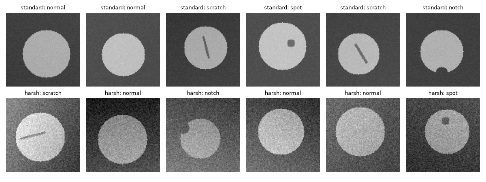
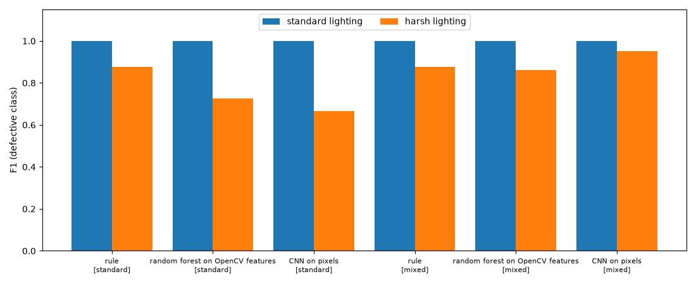

# defect-detection-baselines

零件瑕疵檢測的三種做法，在**光線改變**時的比較：

1. **規則法（OpenCV）**：分割零件，量形狀和表面，再用兩個門檻判斷。
2. **隨機森林（scikit-learn）**：用 OpenCV 算出的 6 個特徵訓練。
3. **小型 CNN（TensorFlow / Keras）**：直接吃原始像素。

> ⚠️ **資料是程式合成的**，不是真實產線的照片。用合成資料的目的是確保每張圖的標準答案百分之百正確，並且能精確控制「光線改變多少」，用來比較方法。結論是方法上的觀察，不代表在真實產線上的準確率。



## 資料

- **影像**：96×96 灰底上一個圓形零件，一半是正常品，另一半平均分成三種瑕疵：
  - **scratch**：刮痕，2 px 寬的暗線
  - **notch**：缺角，邊緣被咬掉一塊
  - **spot**：黑點，半徑 3～5 px
- **兩種光線條件**：

  | 條件 | 對比 | 亮度偏移 | 光線漸層 | 雜訊 |
  |---|---|---|---|---|
  | standard | 0.9～1.0 倍 | ±10 | 最多 15 | std 4 |
  | harsh | **0.35**～1.0 倍 | ±40 | 最多 **90** | std **14** |

- **資料量**：
  - 訓練：1600 張。
  - 測試：standard 和 harsh 各 400 張，用不同的種子產生，和訓練資料不重複。
- **兩種訓練設定**：
  - **standard**：只用標準光線訓練，模擬「只在實驗室收資料」。
  - **mixed**：一半標準光線、一半惡劣光線，模擬「收資料時涵蓋了現場的光線變化」。

## 結果



| 方法 | 訓練資料 | standard 測試 P / R / F1 | harsh 測試 P / R / F1 | 每張推論時間 |
|---|---|---|---|---:|
| 規則法 | standard | 1.00 / 1.00 / **1.00** | 0.83 / 0.93 / **0.88** | 0.24 ms |
| 隨機森林 | standard | 1.00 / 1.00 / **1.00** | 0.57 / 1.00 / **0.72** | 0.26 ms |
| CNN | standard | 1.00 / 1.00 / **1.00** | 0.50 / 1.00 / **0.67** | 0.82 ms |
| 規則法 | mixed | 1.00 / 1.00 / **1.00** | 0.83 / 0.93 / **0.88** | 0.25 ms |
| 隨機森林 | mixed | 1.00 / 1.00 / **1.00** | 0.88 / 0.84 / **0.86** | 0.26 ms |
| CNN | mixed | 1.00 / 1.00 / **1.00** | **1.00 / 0.91 / 0.95** | 0.86 ms |

P = precision（被判成瑕疵的，有多少真的是瑕疵）、R = recall（真的瑕疵，有多少被抓到）。產線上漏檢的代價通常比誤判高，所以要特別看 R。

**harsh 測試中，各類別被判成瑕疵的比例**：

| 方法 | 訓練資料 | scratch | notch | spot | 正常品（誤判率） |
|---|---|---:|---:|---:|---:|
| 規則法 | standard | 0.82 | 1.00 | 0.95 | 0.18 |
| 隨機森林 | standard | 1.00 | 1.00 | 1.00 | **0.76** |
| CNN | standard | 1.00 | 1.00 | 1.00 | **1.00** |
| 規則法 | mixed | 0.82 | 1.00 | 0.95 | 0.18 |
| 隨機森林 | mixed | 0.78 | 0.93 | 0.82 | 0.11 |
| CNN | mixed | 0.94 | 0.78 | 1.00 | **0.00** |

## 觀察

1. **標準光線下三種方法都是滿分**。這說明合成資料在標準條件下太簡單，不能拿來區分方法的好壞。真正的差異都出在光線改變之後。
2. **只用標準光線訓練時，學習式方法反而輸給規則法**。
   - CNN 把 harsh 測試裡**100% 的正常品**都判成瑕疵。它學到的其實是「跟訓練時看過的正常品長得不一樣，就是瑕疵」，而不是「瑕疵長什麼樣子」。
   - 隨機森林也一樣：雜訊讓表面標準差、邊緣密度這些特徵整體上升，超出了它在訓練時看過的範圍。
   - 規則法相對穩定，因為它的特徵本身就是相對的：Otsu 會依照每張圖自動決定門檻，暗點是用「比零件中位數暗多少」來判斷。
3. **訓練資料涵蓋光線變化後，CNN 變成最好的方法**：F1 0.95，正常品的誤判率是 0。但缺角的召回率只有 0.78，還是它的弱點。
   - 規則法只有兩個門檻，加資料也學不到新東西，分數完全沒變。
   - **在這個實驗裡，資料涵蓋的範圍比選哪個模型影響更大。**
4. **規則法在 harsh 下漏掉 18% 的刮痕**：對比降到 0.35 倍時，刮痕只比零件暗約 28，低於固定門檻 40。這和能量法語音偵測在小聲講話時失效是同一個原因：固定門檻遇到整體變暗或變小聲就會失效。
5. **速度**：三種方法在 CPU 上每張都不到 1 ms。實際產線的瓶頸通常在相機取像和機構動作，不在推論。

## 除錯紀錄：CNN 一開始幾乎抓不到瑕疵

第一版 CNN 用 `GlobalAveragePooling2D`，在標準測試上的召回率只有 **0.07**。

- **原因**：瑕疵只佔幾個像素，特徵圖對整張影像取平均之後，局部的強烈反應被大片正常區域稀釋掉了。
- **修正**：改成 `GlobalMaxPooling2D`，保留最強的局部反應；再加上 BatchNormalization 讓訓練更穩定，訓練輪數從 15 增加到 20。
- **結果**：標準測試的召回率變成 1.00。
- **學到的**：模型結構要配合目標的特性。目標是「影像中的一小塊異常」時，聚合方式要能保留局部的極值。

## 方法細節

**規則法**（[`rule_based.py`](defect_detection/rule_based.py)）：

1. 轉灰階，做高斯模糊，再用 Otsu 自動決定門檻，把零件和背景分開。
2. 在輪廓中取面積最大的那一個，當作零件。
3. 量形狀：
   - **solidity** = 輪廓面積 ÷ 凸包面積。缺角會讓輪廓凹進去，solidity 就會下降。
   - **circularity**：越接近正圓，值越接近 1。
4. 量表面：把零件內部往內侵蝕一圈，排除邊緣，計算「比中位數暗 40 以上」的像素比例（dark ratio）。
5. 判斷：`solidity < 門檻` 或 `dark ratio > 門檻` 就算瑕疵。兩個門檻用訓練集做網格搜尋，選 F1 最高的組合。

**隨機森林**：200 棵樹，輸入是 solidity、circularity、dark ratio、零件面積比、內部亮度標準差、Canny 邊緣密度，共 6 個特徵。

**CNN**：Rescaling → 3 層（Conv 3×3 → BatchNorm → ReLU → MaxPool，通道數 16 / 32 / 64）→ GlobalMaxPooling → Dense(1)。優化器 Adam，學習率 1e-3，訓練 20 輪，batch 32，切 10% 當驗證集。

## 限制

- 合成資料比真實資料乾淨得多，沒有反光、材質紋理、對焦模糊這些狀況。
- mixed 訓練看過的 harsh 光線，和測試用的 harsh 光線來自同一個產生器。真實環境出現「訓練時沒看過的變化」時，仍然可能失效，所以上線後需要持續監控。
- 每個設定只跑一個種子，數字有隨機波動，不能把小差距當成結論。
- 這裡只做「整張圖有沒有瑕疵」的分類，沒有標出瑕疵的位置。要標位置需要物件偵測或分割模型。

## 執行

```bash
python -m venv .venv && source .venv/bin/activate
pip install -r requirements.txt
python run_experiments.py           # 約 2 分鐘（M1 Pro CPU），產生上面的表格和 assets/ 裡的圖
python -m unittest discover tests   # 6 個測試
```

## 專案結構

```
defect_detection/
  config.py      所有可調整的數值
  dataset.py     合成影像：零件、三種瑕疵、光線變化
  rule_based.py  OpenCV 分割、形狀與表面特徵、門檻搜尋
  models.py      隨機森林、Keras CNN
  metrics.py     precision / recall / F1
run_experiments.py
tests/
```

## 環境

Python 3.13、OpenCV 5.1、scikit-learn 1.9、TensorFlow 2.21 / Keras 3.15，MacBook Pro（M1 Pro）的 CPU。
